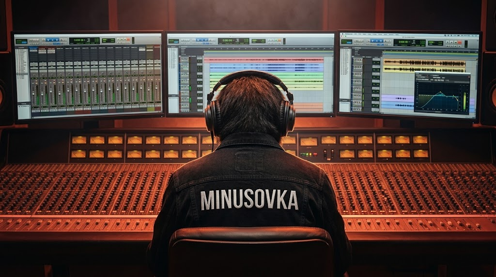

# MINUSOVKA — Студийный нейросетевой звуковой движок

> Профессиональная веб-платформа поканального разделения музыки на 6 изолированных стемов: чистый минус, вокал (акапелла), ударные, бас, гитару и клавишные. Встроенный многоканальный онлайн-микшер, пакетный экспорт и бессрочная медиатека без принудительных подписок и скрытых автопродлений.

[Перейти на платформу](https://minusovka.org) • [Тарифные планы](https://minusovka.org/plans) • [Официальное сообщество VK](https://vk.com/minusovka_org)

---

## ⚡️ О платформе

**MINUSOVKA** решает главную проблему современных вокалистов, аранжировщиков и преподавателей музыки — дефицит качественных инструменталов без остаточного вокального брака и принудительных зарубежных подписок по $20/месяц.

Движок осуществляет глубокий спектрально-фазовый анализ звуковой волны за 30–50 секунд, изолируя аудиопоток на 6 самостоятельных партий студийного уровня.

### Ключевые возможности:

* **6 изолированных стемов:** разделение на инструментал (минус), чистый вокал, ритм-секцию (drums), бас-линию, гитары и клавишные инструменты.
* **Студийное звучание 320 kbps:** отсутствие частотной каши, сжатия и артефактов классических «противофазных задавок».
* **Поканальный веб-микшер:** возможность приглушить голос или отдельные инструменты прямо в браузере и экспортировать кастомный минус под свой диапазон.
* **Пакетное скачивание:** загрузка как отдельных дорожек, так и единого ZIP-архива всего проекта.
* **Бессрочная персональная галерея:** обработанные композиции сохраняются на персональном диске навсегда без риска автоматического удаления.
* **Отказоустойчивость:** защитный сторожевой таймер очереди (Watchdog) и мгновенный возврат баланса при непредвиденных задержках инференса.

---

## 💳 Прозрачная тарификация

В сервисе отсутствуют скрытые списания, виртуальные токены и принудительные автопродления. Купленные попытки **никогда не сгорают**.

| Тариф | Стоимость | Баланс | Юнит-цена за песню | Особенности |
| :--- | :--- | :--- | :--- | :--- |
| **1 разделение** | 49 ₽ | 1 трек | **49 ₽** | Разовый старт, без подписки и привязки карт |
| **Стандарт** | 390 ₽ / 30 дней | 10 треков | **39 ₽** | Базовый набор для вокалистов и преподавателей |
| **PRO** | 990 ₽ / 30 дней | 35 треков | **~29 ₽** | Параллельная обработка 2 треков, 10 ГБ диска |
| **Премиум** | 1 990 ₽ / 30 дней | 100 треков | **19.9 ₽** | Максимальный приоритет очереди, до 4 задач параллельно |

---

## 🛠 Технологический стек

* **Frontend:** React 18, Vite, TypeScript, Web Audio API, Responsive Layout.
* **Backend:** Node.js, Express, TypeScript, Prisma ORM, MySQL.
* **Очереди и сессии:** Redis, Distributed Job Queue, Heartbeat Watchdog.
* **Инфраструктура:** Изолированные контейнеры Docker, выделенные Serverless GPU-кластеры.
* **CDN & Хранилище:** S3-совместимое объектное хранилище с дисковой акселерацией статики.

---

## 🤝 Партнёрство и B2B

Мы открыты для прямого сотрудничества с музыкальными организациями:
* **Вокальные студии и музыкальные школы:** пакетная генерация минусовок для учеников и конкурсов.
* **Караоке-клубы и банкетные площадки:** быстрая подготовка редких композиций по запросу гостей.
* **Битмейкеры и продюсеры:** интеграция пайплайна сэмплирования и извлечения акапелл.

По вопросам сотрудничества: **hello@minusovka.org**  
Техническая поддержка: **support@minusovka.org**

---
© 2026 MINUSOVKA • Студийный звуковой движок
